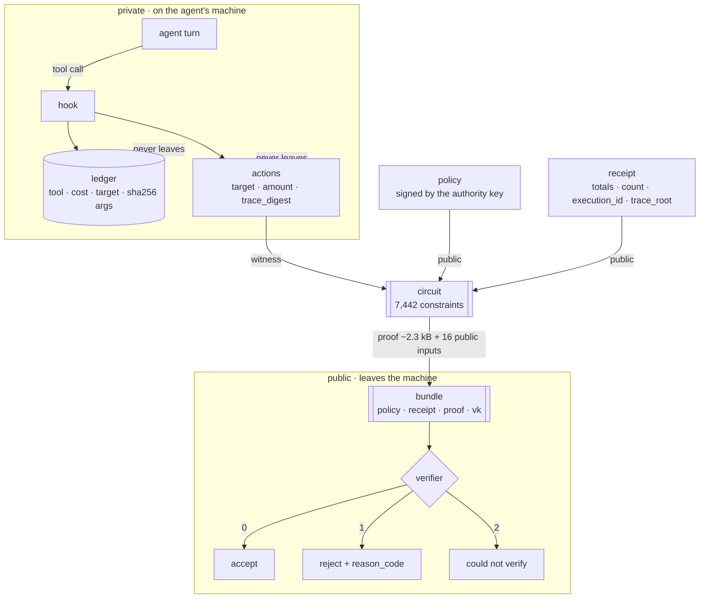

# Information flow

What goes in, what comes out, and what never leaves. Read this before changing a struct: every field
lands on one side of a trust boundary, and moving one changes what a verifier learns.

## 1. The flow, with boundaries



The two arrows that matter are the dotted ones: the ledger and the actions stay on the machine. What
crosses is a proof over them.

## 2. What each artifact contains

| artifact | fields | side |
| --- | --- | --- |
| `policy.json` | `max_amount`, `max_per_action`, `expires_at`, `chain_id`, `allowed_targets` | public |
| `receipt.json` | `total_amount`, `action_count`, `completed_at`, `chain_id`, `execution_id`, `trace_root` | public |
| `proof.json` | `format_version`, `public_inputs` (16), `proof` (bytes) | public |
| actions (witness) | `target`, `amount`, `trace_digest` per action | **private** |
| ledger row | tool name, cost, target, `sha256(canonical args)` | **private** |
| keys | `vk.bin` public · `authority.hex` and `pk.bin` never shared | mixed |

Public inputs are 16: eight for the policy, eight for the receipt. They are the only numbers the
verifier sees besides the proof, which is why `total_amount` and `action_count` are checkable while
the actions are not.

## 3. The verdict contract

```json
{"verdict": "accept", "reason": null, "reason_code": null, "execution_id": 1001, "format": 3}
```

| exit | verdict | meaning |
| --- | --- | --- |
| 0 | `accept` | the proof verifies against this policy, receipt and key |
| 1 | `reject` | verified and refused: `public_input_mismatch`, `cap_exceeded`, `already_accepted` |
| 2 | `could not verify` | the verifier itself could not run: unreadable artifact, wrong key, bad format |

Exit 2 is not a rejection. A caller that treats "could not verify" as "rejected" will reject honest
work the moment a key is missing, and a caller that treats it as "accepted" will pass a forgery.
Branch on the verdict, never on English.

## 4. Where the plugin puts it

```
plugin-data/zkagent-attest/
  state.json        session header: costs, runs, next_run_id, cap_refusals, guard digest
  pending.jsonl     the ledger rows not yet attested
  session.json      the index: receipts in order, one Merkle root, one total
  seen.json         replay guard: accepted executions and sessions
  runs/run-N/       policy.json · receipt.json · proof.json · actions.json
  keys/             vk.bin (public), pk.bin (proving, not secret), authority.hex (0600)
```

`actions.json` is the witness: it is written beside the proof so the run can be re-proved, and it is
the one file in `runs/` that must never be published with the receipt.

## 5. What this flow does not prove

- **completeness** — the ledger is written by the agent, so the proof covers what was recorded
- **signer identity** — the policy is signed by a key this machine generated; single-party setup
- **anything about the actions** — they stay private, by construction

Those three sentences appear in `CONSTITUTION.md`, in the plugin README, and here, because a flow
diagram that omits them flatters the system.
